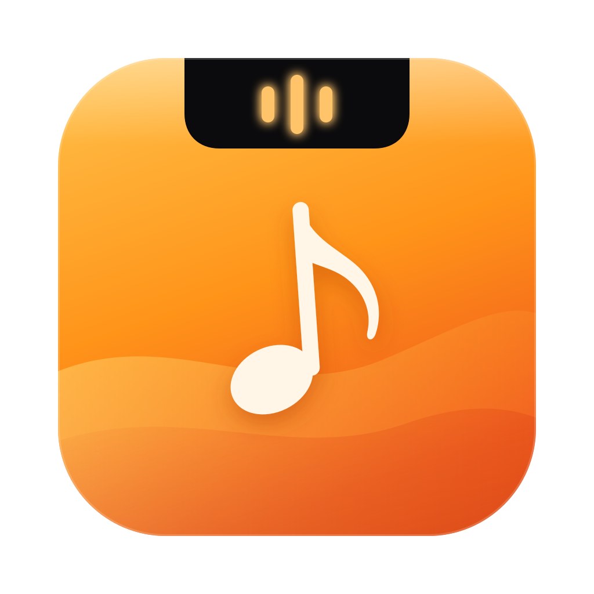
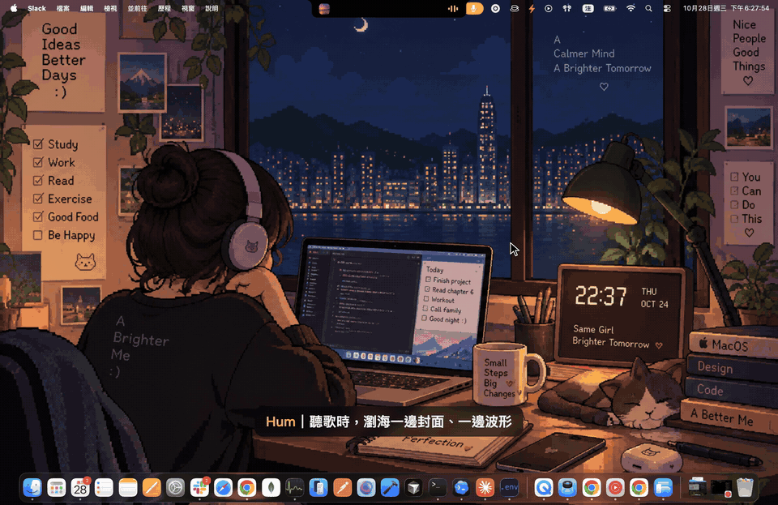
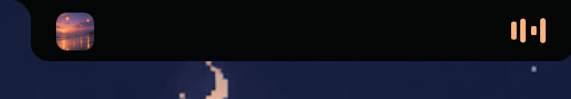
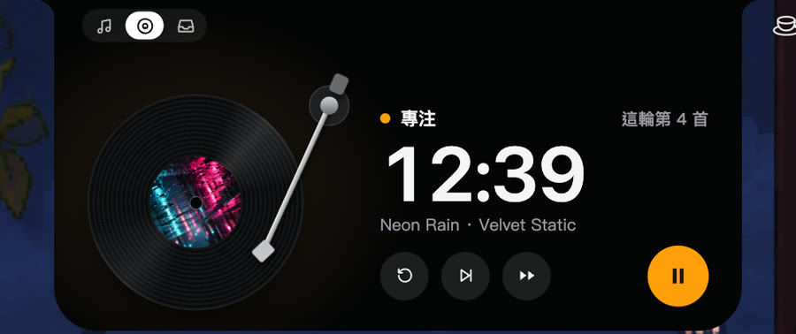

  

<h1 align="center">Hum</h1>

  A Dynamic Island for your Mac's notch — now playing, lyrics, and a record-player focus timer. 
  <a href="README.zh-TW.md">繁體中文</a>

  <a href="https://github.com/Charonyuu/hum-app/releases/latest/download/Hum-mac.dmg"><b>Download for Mac</b></a> ·
  <a href="https://github.com/Charonyuu/hum-app/releases/latest/download/Hum-win-x64.zip">Windows</a> ·
  <a href="https://github.com/Charonyuu/hum-app/issues">Report a bug</a>

  

Full-quality video: <a href="docs/media/hum-music-focus.mp4">hum-music-focus.mp4</a>

## Features

| | |
|---|---|
|  | **Lives in the notch.** Album art on one side, a live waveform or timer on the other. Hover to expand; it never steals focus or blocks the menu bar. |
|  | **Focus deck.** The current song becomes a spinning record and the tonearm is your timer — it reaches the label when the session ends. Music fades out on breaks and back in when you return. |

- **Now playing** from Apple Music, Spotify, and browser tabs (YouTube, YouTube Music, Spotify Web, SoundCloud, bilibili) in Chrome, Arc, Brave, Edge and Safari
- **Synced lyrics** under the notch or in the expanded card
- **Up next** queue for Music and YouTube Music
- **Volume and battery HUDs** in place of the system overlays
- **File shelf** — drop files on the island, drag them back out later
- **Light on resources** — about 0.3% CPU while playing
- Respects **Reduce Motion**; works on Macs without a notch as a floating pill

## Install

### Mac

macOS 14 or later. Download [`Hum-mac.dmg`](https://github.com/Charonyuu/hum-app/releases/latest/download/Hum-mac.dmg), drag Hum to Applications and open it. The app is signed and notarized by Apple.

Hum has no Dock icon. Right-click the island (or use the menu bar icon) for settings.

- The first time it reads Music or Spotify, macOS asks for **Automation** permission.
- For browser tabs, turn on *Allow JavaScript from Apple Events* in the browser's Developer menu. The expanded card shows a hint when it's needed.

### Windows

Windows 10 2004+ or Windows 11, x64. Download [`Hum-win-x64.zip`](https://github.com/Charonyuu/hum-app/releases/latest/download/Hum-win-x64.zip), unzip it and run `Hum.exe`. No installer or .NET install needed.

The Windows build isn't code-signed yet, so SmartScreen may warn you: choose **More info → Run anyway**.

## Feedback

Found a bug or want a feature? [Open an issue](https://github.com/Charonyuu/hum-app/issues).

## License

Hum is free to download and use. The source code is not public.

© 2026 Charonyuu. All rights reserved.

Third-party components: [THIRD_PARTY_NOTICES.md](THIRD_PARTY_NOTICES.md).
