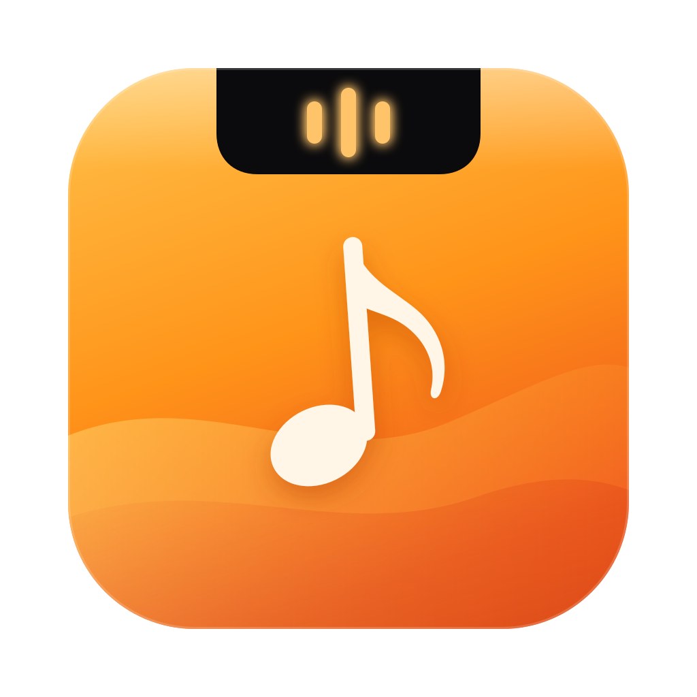
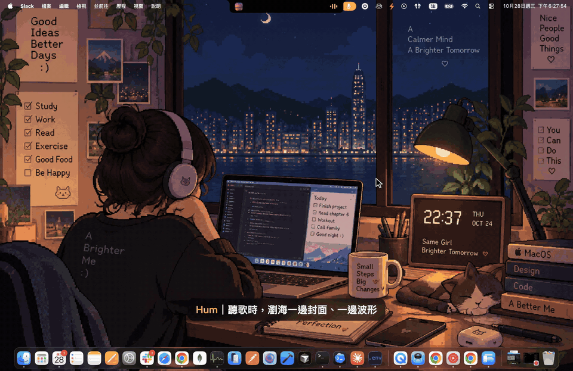
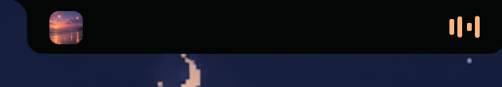
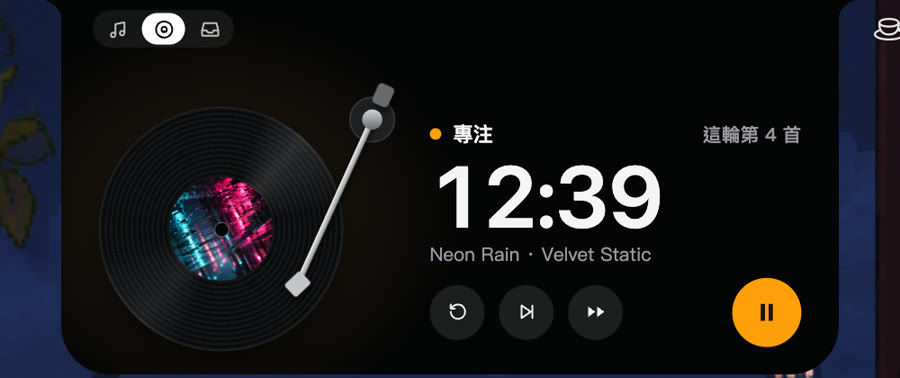

  

<h1 align="center">Hum</h1>

  住在 Mac 瀏海裡的動態島 — 正在播放、即時歌詞、唱盤專注計時。 
  <a href="README.md">English</a>

  <a href="https://github.com/Charonyuu/hum-app/releases/latest/download/Hum-mac.dmg"><b>下載 Mac 版</b></a> ·
  <a href="https://github.com/Charonyuu/hum-app/releases/latest/download/Hum-win-x64.zip">Windows 版</a> ·
  <a href="https://github.com/Charonyuu/hum-app/issues">回報問題</a>

  

高畫質影片：<a href="docs/media/hum-music-focus.mp4">hum-music-focus.mp4</a>

## 功能

| | |
|---|---|
|  | **住在瀏海裡。** 一邊封面、一邊波形或倒數。滑鼠移入展開，不搶焦點、不擋選單列。 |
|  | **音樂專注唱盤。** 正在播的歌變成旋轉的唱片，唱臂就是計時器，走到標籤邊緣＝這輪結束。休息時音樂淡出，回來專注再淡入。 |

- **正在播放**：Apple Music、Spotify，以及 Chrome／Arc／Brave／Edge／Safari 裡的 YouTube、YouTube Music、Spotify Web、SoundCloud、bilibili
- **同步歌詞**：顯示在瀏海下方或展開卡片
- **待播清單**：Music、YouTube Music
- **音量／電量 HUD** 取代系統提示
- **檔案暫存區**：把檔案拖到動態島，之後再拖出來
- **省資源**：播放中約 0.3% CPU
- 尊重「減少動態效果」；沒有瀏海的螢幕顯示獨立膠囊

## 安裝

### Mac

macOS 14 以上。下載 [`Hum-mac.dmg`](https://github.com/Charonyuu/hum-app/releases/latest/download/Hum-mac.dmg)，拖進「應用程式」後開啟。已簽署並經 Apple 公證。

Hum 不在 Dock 顯示。在動態島按右鍵（或選單列圖示）開啟設定。

- 第一次讀取 Music 或 Spotify 時，macOS 會詢問「自動化」權限。
- 瀏覽器分頁需在瀏覽器「開發者」選單開啟「允許 Apple 事件中的 JavaScript」，需要時展開卡片會提示。

### Windows

Windows 10 2004 以上或 Windows 11，x64。下載 [`Hum-win-x64.zip`](https://github.com/Charonyuu/hum-app/releases/latest/download/Hum-win-x64.zip)，解壓縮後執行 `Hum.exe`，不用安裝也不用另外裝 .NET。

Windows 版還沒有程式碼簽章，SmartScreen 可能會跳警告：按「其他資訊 → 仍要執行」。

## 意見回饋

遇到問題或想要新功能？[開 issue](https://github.com/Charonyuu/hum-app/issues)。

## 授權

Hum 可免費下載使用，原始碼不公開。

© 2026 Charonyuu. All rights reserved.

第三方元件：[THIRD_PARTY_NOTICES.md](THIRD_PARTY_NOTICES.md)。
